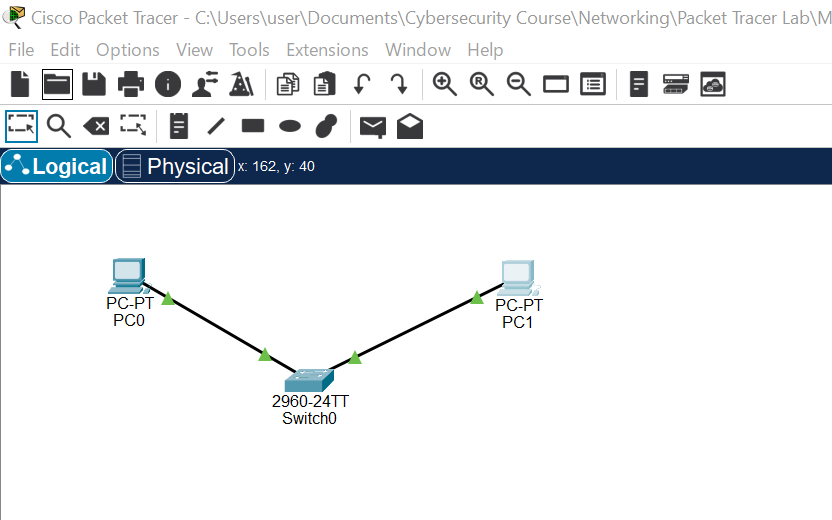
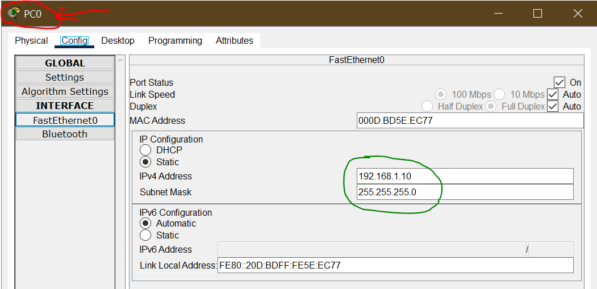
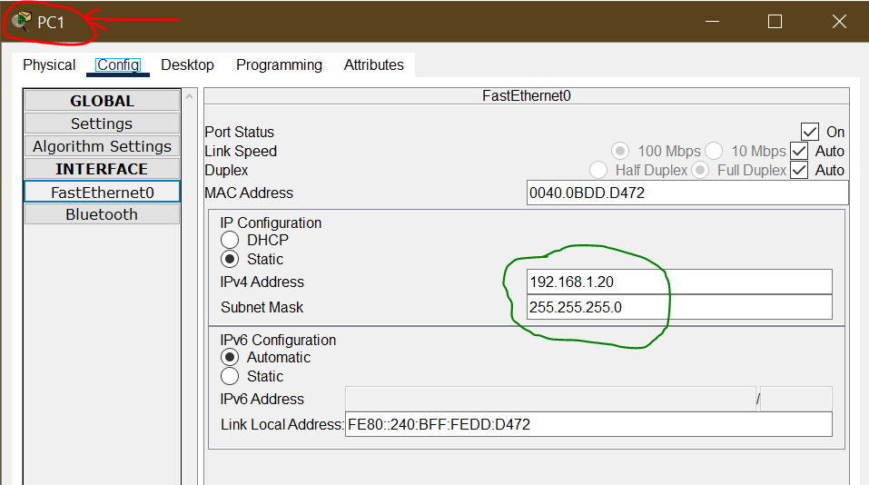
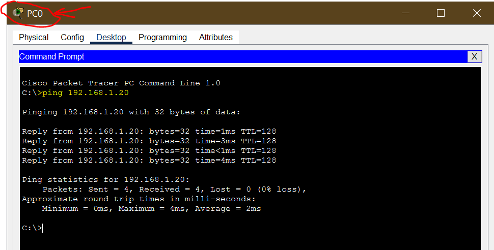
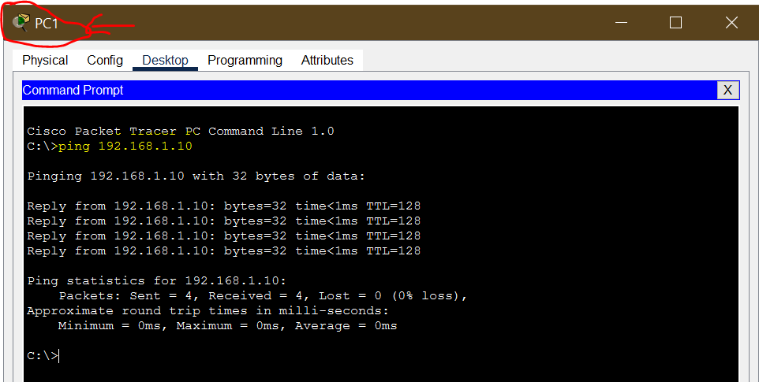

**BUILT MY FIRST LAN**

**Fig. 1.1: Connected two (2) PCs (PC0 and PC1) and a server to a switch (Switch0)
using Copper Straight-Through cables.**

**Cables are connected to the Fast Ethernet Port on both ends.**

**Fig. 1.2: Configured the IP Addresses of both PC devices (PC0 and
PC1).**

**Fig. 1.3: Ping both devices to confirm successful communication.**

